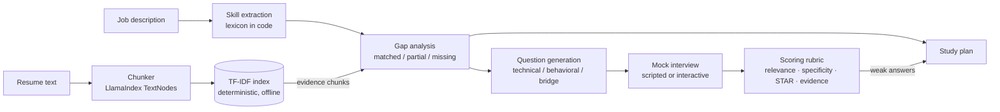

# Agent Interview Prep

Interview prep is scattered. Your resume says one thing, the job description asks for another, and you walk in hoping the right story comes to mind when the interviewer asks about the one skill you quietly don't have.

This agent takes a **resume + a job description** and turns them into a prep session: a gap analysis (matched / partial / missing, each backed by the resume snippet that proves it), likely interview questions mapped to your actual experience, a scored mock interview, and a prioritized study plan. Gaps get "bridge" questions with honest framing — name the gap, connect your nearest experience, give a ramp-up plan — instead of bluffing.

## How it works



- **Skill extraction** (`skills.py`) — a curated lexicon of ~30 skills with aliases and adjacent terms. The JD is scanned for mentions; mention count becomes the requirement's importance weight. No prompt decides what counts as a skill.
- **Retrieval** (`retrieval.py`) — the resume is chunked into LlamaIndex `TextNode`s and indexed with a small pure-Python TF-IDF retriever. Every gap verdict cites the chunk that supports it.
- **Gap analysis** (`gaps.py`) — alias in resume → *matched*; only a related term → *partial* (adjacent experience); neither → *missing*. Rules in code, evidence attached.
- **Questions** (`questions.py`) — one per requirement, mapped to the evidencing resume chunk. Missing skills become bridge questions with a suggested honest framing anchored on your nearest experience.
- **Mock interview + scoring** (`mock_interview.py`, `scoring.py`) — scripted deterministic candidate in demo mode (or `--interactive` to answer yourself). Each answer is scored 0–5 on relevance, specificity, STAR structure, and evidence overlap with your resume chunk — token/marker checks in code, so the same answer always gets the same score.
- **Study plan** (`study_plan.py`) — missing skills first (by JD mention count), then partials, then matched skills whose mock answers scored weak. Concrete actions and a practice question per item.

The agent loop (`agent.py`) runs these as typed tools (`tools.py`, pydantic schemas) in sequence. The system prompt (`prompts.py`) is behavior-only; every checkable rule lives in code.

## Why LlamaIndex

The core move in this agent is **retrieval**: index the resume, then for every JD requirement pull the experience that actually evidences it. That's LlamaIndex's home turf — documents, nodes, indexes, retrievers, and an agent layer on top. Mock mode uses LlamaIndex's `Document`/`TextNode` model with a local TF-IDF retriever behind the standard `retrieve(query, top_k)` interface; live mode swaps in a LlamaIndex `VectorStoreIndex` with Gemini embeddings and a `FunctionAgent` driving the same tools.

Two honest caveats about mock mode, found while building this: LlamaIndex's `KeywordTableIndex` downloads NLTK stopwords data on first use, and its `SentenceSplitter` needs NLTK tokenizer data — both break a strict no-network contract. And `VectorStoreIndex` with `MockEmbedding` returns near-identical vectors, so its ranking is meaningless. So mock mode chunks and indexes locally (pure Python, deterministic) while keeping LlamaIndex's data model. Live mode is where the full LlamaIndex stack runs.

## Quickstart

```bash
git clone https://github.com/balasaikunapareddi/agent-interview-prep
cd agent-interview-prep
python3 -m venv .venv && .venv/bin/pip install -e ".[dev]"

make test    # 34 tests, no API key, no network
make demo    # bundled backend-engineer resume vs AI/ML-engineer JD
```

Bring your own documents:

```bash
.venv/bin/interview-prep-demo --resume my_resume.txt --jd job.txt
.venv/bin/interview-prep-demo --interactive   # answer the questions yourself
```

Demo output (abridged, from the bundled samples):

```
MATCHED (12):
  - Machine learning (JD mentions: 3)  [scikit-learn, churn-prediction]
      evidence: "…trained a scikit-learn gradient-boosting model on customer activity data (holdout AUC 0.81)…"
PARTIAL (adjacent experience) (7):
  - RAG (JD mentions: 3)  [search, tf-idf]
      evidence: "…built a small TF-IDF search tool over personal notes in pure Python."
MISSING (8):
  - LLMs (JD mentions: 5)
  - Vector databases (JD mentions: 5)
  ...

6. [bridge] Your resume shows search, tf-idf experience. This role needs RAG — how would you extend what you've done to cover it?

MOCK INTERVIEW
4. Machine learning: 17.5/20  (rel 2.5, spec 5.0, struct 5.0, evid 5.0)
6. RAG: 12.2/20  (rel 5.0, spec 2.5, struct 1.2, evid 3.5)
   -> Missing STAR shape — set the scene, your task, what you did, and the result.

STUDY PLAN
1. LLMs — missing from resume; JD mentions it 5×
   - Build a small LLM extraction prototype (structured output from messy text) and write up what broke.
```

### Live mode (optional)

```bash
.venv/bin/pip install -e ".[live]"
export GEMINI_API_KEY=...
```

Live mode (`live.py`) builds a LlamaIndex `VectorStoreIndex` over the resume with Gemini embeddings and a `FunctionAgent` (Gemini) that calls the same typed tools conversationally. **Not exercised by the test suite** — no key in CI; the code paths are import-guarded and documented, the mock path is the verified one.

## What's real vs mocked

| Piece | Mock mode (default) | Live mode |
|---|---|---|
| Chunking | Local sentence packer → LlamaIndex `TextNode`s | Same |
| Retrieval | Pure-Python TF-IDF + cosine, deterministic | LlamaIndex `VectorStoreIndex` + Gemini embeddings |
| Skill extraction / gap rules | Lexicon + rules in code (real) | Same code |
| Question generation | Templates in code (real) | Same tools, agent-driven |
| Candidate answers | Scripted `MockCandidate` (deterministic) | Human via `--interactive`, or agent role-play |
| Scoring | Token/marker rubric in code (real) | Same rubric |
| Agent loop | Deterministic orchestration over typed tools | LlamaIndex `FunctionAgent` + Gemini |

## Limitations

- Skill matching is lexical: aliases and related terms from a curated lexicon. It will miss skills phrased unusually and can't judge depth — "matched" means *mentioned with evidence*, not *expert*.
- TF-IDF retrieval is keyword-based; semantic matches (e.g. "built search" → RAG) only register through the lexicon's related terms.
- The scoring rubric checks surface signals (numbers, STAR markers, term overlap). It can't tell whether an answer is *correct*, only whether it's specific, structured, and grounded.
- Live mode is implemented but untested (no Gemini key in the test environment).
- Sample resume/JD are fictional and written to exercise every code path.
